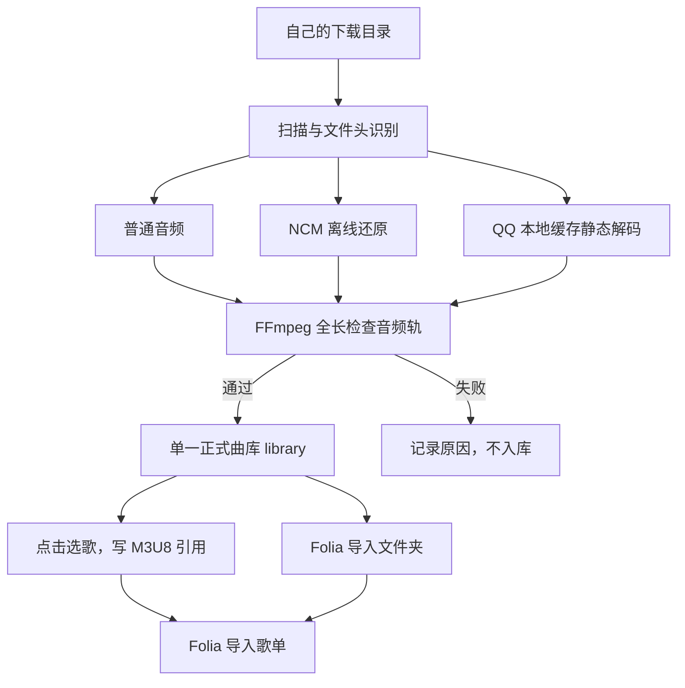

# Local Music Toolkit · 本地音乐工具

**作者：AAAxlt、Codex（OpenAI）、DeepSeek。** 项目账号与维护者：AAAxlt。

扫描自己的音乐下载目录，将可处理的文件加入一个本地曲库；点击选歌并生成 M3U8 歌单。歌单只记录歌曲位置，**不会复制音频**。

这是脚本项目，当前提供 Windows 双击入口。Python/Node 核心脚本包含跨平台回归测试；QQ 客户端辅助流程仅适用于 Windows。

## 可以做什么

- 扫描一个或多个配置目录，识别普通 MP3、FLAC、OGG、M4A、WAV 和 NCM。
- NCM 在本机离线处理；解出来的容器保持原格式，不做有损转码。
- 发布前用 FFmpeg 完整解码校验，处理失败的文件不会加入正式曲库。
- 保留原下载文件，记录来源及输出哈希，重复运行跳过未变化的下载。
- 管理一个输出目录，规范化经过校验的 FLAC/OGG 尾部，并归档陈旧输出。
- 搜索、点击、多选歌曲，调整歌单顺序，保存、重新打开 M3U8。
- 默认生成**相对于歌单文件**的歌曲路径；同时移动曲库与歌单目录后仍可使用。可勾选“使用绝对路径”适配需要完整路径的播放器。跨 Windows 盘符时自动退回绝对路径。

QQ MFLAC/MGG 的新默认入口从本机缓存独立读取各文件材料并走 QMC 静态解码，**不使用 Frida、qqd 或 QQ DLL**；缺少对应缓存材料时明确等待。MGG 不再按后缀默认跳过，但和 MFLAC 一样受逐曲材料、客户端版本与容器布局边界限制。普通音频与 NCM 不需要 QQ。该路线不承诺所有 QQ 文件，本轮 6 首 MGG、2 首 MFLAC、2 首 NCM 和 3 种普通音频已通过本机完整验收。

**自动配置与单命令解码**：运行 `decode-music.cmd "下载目录"`；缺少运行库时会自动配置。支持普通音频、NCM 和 QMC（MFLAC/MGG；musicex 需缓存就绪），原件只读，输出到独立目录；`decode-mflac.cmd` 是同入口别名。首次配置也可单独运行 `bootstrap-decoder.cmd`，新 agent 先读 [AGENTS.md](AGENTS.md)。使用条件、格式状态与验收范围见 [自动配置与解码](docs/agent-decoder.md) 和 [格式支持与验收状态](docs/format-support.md)。

若报告 MFLAC 或 musicex MGG 缺少本地材料，再从桌面打开 QQ、登录，在下载/本地歌曲列表中手动播放对应的已下载原件，确认声音和进度后重跑；[具体步骤](docs/agent-decoder.md#缺少材料时手动准备)。MGG 的来源、歌曲样本及音质关系见 [MGG 来源与音质](docs/mgg-origin.md)。


部分算法来自 Unlock Music，已保留作者署名、固定来源版本与 MIT 全文，见 [第三方声明](THIRD_PARTY_NOTICES.md)。

## 我们实际怎么解码

我们用这套流程把 QQ／网易云下载整理成一个播放器可读的曲库：**识别真实格式 → 对应路线还原 → 完整音频校验 → 整理去重 → 歌单只引用正式音频**。不是改扩展名，也不是一律转成 MP3。

| 文件 | 实际采用的处理方式 | 输出 |
| --- | --- | --- |
| 普通 FLAC／OGG／MP3 等 | 保留原下载，校验并收集到曲库 | 原编码的普通音频 |
| 网易云 NCM | 本地离线还原音频；新解码入口无需 Node | 按真实文件头确定 MP3／FLAC 等格式 |
| QQ musicex v1 MFLAC／MGG | 新入口从本机逐曲缓存取得材料并静态解码，无 Frida 依赖 | 六首 MGG、两首 MFLAC 完整验收通过；具体条件见格式支持表 |



例如我们新增的 `toe,土岐麻子 - グッドバイ -album version-.ncm`，在本机离线还原为 MP3，完整校验后整理进曲库；QQ 的一个 MFLAC 隔离样本则借助客户端恢复为 FLAC，与旧有效产物的 SHA-256 一致。历史批量里 133 个 MFLAC 成功，也有 10 个独立 MGG 产物不合法而被拒绝，因此不能把部分成功写成全部格式兼容。

**会员下载格式也做了新样本验证**：2026-10-12 下载的 `孙燕姿 - 开始懂了.ncm`，离线还原为约 4 分 31 秒的 MP3，44.1 kHz 双声道，完整解码无错误，原下载哈希未变。结果只覆盖这份 NCM 样本，不承诺所有会员歌曲或音质档位通用。

解密之后的 FFmpeg 检查把音频从头到尾解码到空输出，**不播放、不另存转码文件**。它用于确认候选文件是否完整；整理器进一步检查容器尾部和标签写入，原下载始终保留。

完整解释、源码入口、真实验证范围、增量判断和报告位置见 **[我们实际怎么解码与整理](docs/decoding-pipeline.md)**。

## 环境要求

独立解码入口由 `bootstrap-decoder.cmd` 自动配置项目内运行库；下表是原有曲库整理与界面工具的环境要求。

| 组件 | 建议与已验证范围 | 用途 |
| --- | --- | --- |
| Windows | Windows 11 已验证 | 双击入口与 QQ 客户端辅助流程 |
| Python | 建议 Python 3.12；本机验证 3.12.8 | 曲库整理、图形选歌、调用导入流程 |
| Node.js | 建议 22 或 24 LTS；本机验证 24，自动测试使用 22 | 文件扫描、NCM 离线处理、外部 QQ 工具适配 |
| FFmpeg + ffprobe | 两个程序都需要；本机验证 FFmpeg 9.0.2 | 完整音频解码校验、容器和音频包检查、尾部规范化 |
| Mutagen + Pillow | 由 `setup.cmd` 按 `requirements.txt` 安装 | 音频标签、内嵌封面和图片处理 |
| QQ 音乐 PC 客户端 + Frida 路线的辅助工具 | **仅旧版客户端辅助流程需要，新解码入口不需要**，要求匹配客户端和辅助工具版本 | 借助运行中的客户端处理本机已下载的加密文件 |

Node.js 20 不再作为新安装的推荐版本。新用户选官网标为 LTS 的版本即可。

下载、安装、PATH 设置、Python 虚拟环境以及常见报错见 **[环境安装与自检](docs/environment.md)**。

## 旧版 QQ 客户端辅助路线（可选）

本节保留原有导入器的客户端辅助说明。新用户优先使用上面的 `decode-music.cmd` 与 [格式支持表](docs/format-support.md)，无需为新入口安装 Frida。

三类文件走不同流程：普通音频直接校验导入；NCM 由仓库内的离线实现处理；QQ 加密文件使用可选的外部客户端辅助工具。

Frida 是动态插桩框架，可以观察运行中程序的函数和数据。QQ 路线的思路是：先让用户自己的 QQ 音乐客户端完成登录并实际播放一首歌，加载播放/解密模块，再由相匹配的 Frida 辅助工具利用客户端运行时所需的信息处理**已经下载到本机的文件**。本仓库负责扫描、暂存副本、调用工具、验证输出和发布到曲库。

```text
自己的 QQ 下载文件
  → 已登录且真正播放过歌曲的 QQ PC 客户端
  → 与该客户端版本匹配的 Frida 辅助工具
  → 普通 FLAC / OGG 等候选音频
  → FFmpeg 完整解码校验
  → 校验通过才加入 library
```

**Frida 本身不是 QQ 解码器**；安装 `frida-tools` 不会自动补出本仓库缺少的 QQ 辅助程序。当前适配器面向 `qqmusic_des.exe` 的交互协议，其他 Frida 程序需要另写适配器。

详细前提、工具边界、配置示例、启用命令以及失败排查见 **[QQ 音乐／Frida 路线](docs/qq-decoding.md)**。可用配置样例是 [`config.qq.example.json`](config.qq.example.json)，默认仍关闭 QQ 辅助处理。

## 第一次使用（Windows）

1. 从仓库页面点 **Code → Download ZIP**，解压到自己的目录。
2. 按[环境安装与自检](docs/environment.md)安装 Python、Node.js LTS、FFmpeg 与 ffprobe，并检查命令可用。只有需要 QQ 加密处理时才准备 QQ 客户端和相匹配的外部辅助工具。
3. 双击 `setup.cmd`，Python 依赖安装在项目自己的 `.venv` 目录。成功后生成个人 `config.json`。
4. 编辑 `config.json` 的 `sourceDirs`，填入自己的下载目录。所有相对路径**以配置文件所在目录为基准**，不会随着启动位置改变。
5. 双击 `refresh.cmd`。保留的歌曲在 `library`，报告在 `.reports`。初次输出目录应为空。
6. 双击 `playlist.cmd`，搜索并点击加入歌曲，填写歌单名后保存。生成的文件在 `playlists`。也能选择自己已有的本地曲库。

示例配置默认读取项目下的 `downloads`。也可以设置自己的绝对路径，例如：

```json
"sourceDirs": ["E:/MusicDownloads", "./downloads"]
```

`outputDir`、`libraryDir` 和 `organizedDir` 应保持指向同一个受管理目录。原下载目录与输出目录分开设置。

## 命令行

```powershell
# 查看扫描计划，不解码、不写曲库
.\.venv\Scripts\python.exe src\refresh-library.py --preview

# 默认离线更新曲库
.\.venv\Scripts\python.exe src\refresh-library.py

# 列出可选歌曲
.\.venv\Scripts\python.exe src\make-playlist.py --list

# 按歌手或歌名关键词建单
.\.venv\Scripts\python.exe src\make-playlist.py --name "精选" --match "歌手名字,歌名"

# 需要绝对歌曲路径时
.\.venv\Scripts\python.exe src\make-playlist.py --name "精选" --match "歌名" --absolute
```

封面歌词使用已有本地资料。只有明确传入 `--online` 才进行元数据查询，不上传音频。QQ 辅助处理需要自行配置 `qqd` 并明确传入 `--allow-qqd`；不要把未配置的兼容性当作已经通过。

```powershell
# 已准备 QQ 辅助工具、登录客户端并实际播放过歌曲后，显式启用
.\.venv\Scripts\python.exe src\refresh-library.py --config config.json --allow-qqd

# Windows 双击入口也接受同样的开关
.\refresh.cmd --allow-qqd
```

## Folia 使用实例：一份曲库，多个歌单

我们最后采用的结构如下。可分享项目默认使用 `library`／`playlists`，本机分别命名为“全部歌曲”／“歌单”：

```text
本地音乐/
├─ 全部歌曲/             ← Folia 先导入这个目录
│  ├─ AGA - 孤雏.flac
│  ├─ 爱乐团王超 - 天涯.ogg
│  └─ toe_土岐麻子 - グッドバイ -album version-.mp3
└─ 歌单/
   └─ Axlt.m3u8          ← 然后导入歌单
```

1. 更新曲库，确认报告中歌曲已通过校验。
2. 在 Folia 本地音乐区域点“导入文件夹”，选正式曲库，等待扫描结束。
3. 双击 `playlist.cmd`，搜索、选歌、排序并保存 M3U8。
4. 在 Folia 点“导入歌单”，选择刚保存的文件，核对歌曲数量后播放。

M3U8 只写路径，例如 `../library/AGA - 孤雏.flac`。Folia 会在**已经导入的曲库**里匹配歌曲，不能只导入歌单就期待它自动扫描磁盘。[Folia 官方说明](https://github.com/chthollyphile/folia-major/blob/main/docs/local-library-management.md#导入与导出-m3u-歌单)

我们曾遇到“81 条路径找不到或有歧义”的提示，后来统一正式目录、更新歌单引用并复核匹配。2026-10-12 检查：曲库 174 首，Axlt 歌单 110 条路径全部存在；按已安装 Folia 的匹配逻辑检查，110 匹配、0 缺失、0 歧义。这是文件和匹配检查的结果，不等于此次重新逐首播放。

**想直接试一遍？** [完整 Folia 实例](docs/folia-example.md)包含一个可运行的小演示：生成两段原创测试音 → 用正式入口导入 → 生成两项 M3U8 → 在 Folia 先导入文件夹、再导入歌单。仓库不附带真实歌曲。

## 目录

```text
src/                  扫描导入、NCM 处理、曲库维护、歌单编辑器
tests/                自动生成音频的回归测试
config.example.json   可分享的示例配置
config.qq.example.json  带 QQ 辅助工具字段的示例，默认关闭
docs/                 环境、解码原理、QQ／Frida 与 Folia 实例
examples/             可自行生成的 Folia 测试音演示
config.json           自己的配置，不上传 Git
downloads/            原下载文件，不上传 Git
library/              处理后的曲库，不上传 Git
playlists/            自己的歌单，不上传 Git
.work/ .cache/        临时文件与缓存，不上传 Git
.reports/ .backups/   报告与可恢复备份，不上传 Git
```

## 更新到自己的 GitHub

首次上传可在 GitHub 点右上角 **+ → New repository**，填写名称并选择可见性。上传的是此项目的代码和示例配置，个人配置、歌曲与运行数据由 `.gitignore` 排除。

已克隆或关联仓库后，在项目目录执行：

```bash
git status
git add src tests docs examples README.md config.example.json config.qq.example.json
git commit -m "Update music tools"
git push
```

先看 `git status`，确认提交内容是预期的代码文件。也可以使用 GitHub Desktop 查看改动，点击 **Commit to main → Push origin**。

公开仓库可以直接给朋友分享仓库链接或下载 ZIP 链接，下载无需 GitHub 账号。修改和提交代码仍需要对应权限。

## 测试

```bash
python -m unittest discover -s tests -p "test_*.py"
node --test tests/test-import.mjs
```

测试生成临时音频，检查相对路径、重名保护、增量导入、原文件不变、受管理目录改名后的引用以及音频校验。测试数据不包含真实歌曲。

## 项目状态与依赖

从本机已使用的脚本拆分，当前为第一版。Python 依赖为 Mutagen 与 Pillow；Node.js 侧使用内置模块。FFmpeg 和可选 QQ 辅助程序由使用者自行安装。

仓库目前未指定开源许可证。公开可查看与下载，并不代表自动采用某个开源许可证；后续如需开放代码复用，可再添加明确的许可证。第三方依赖各自遵循其原许可证。
