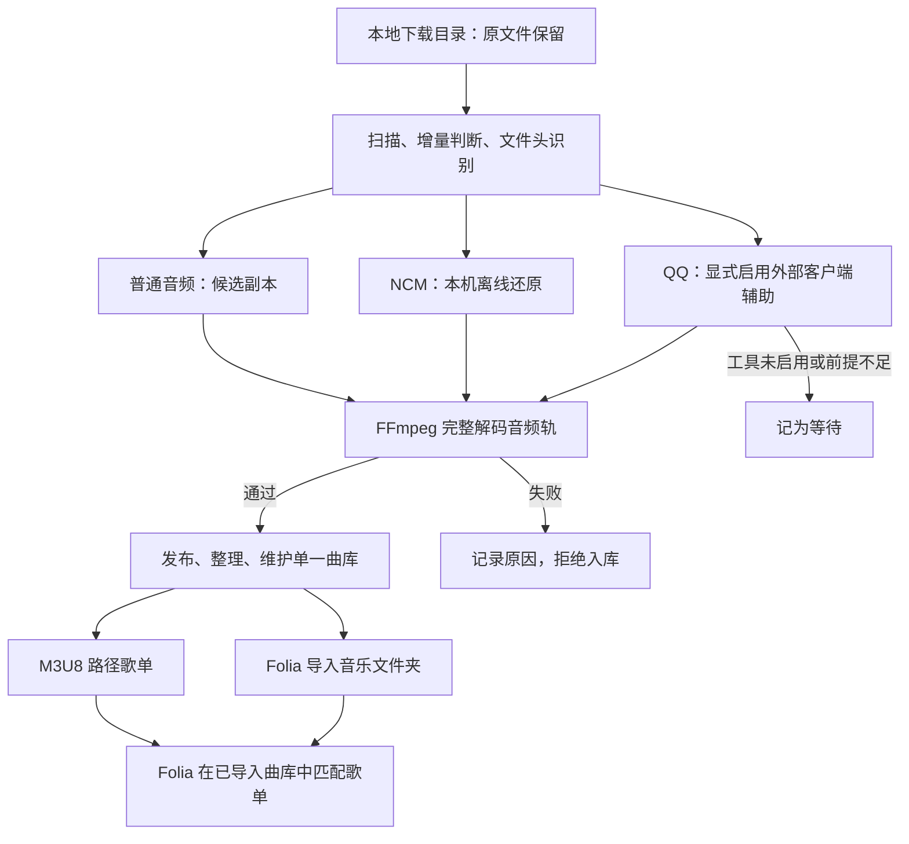

# 我们实际怎么解码与整理

当前新增的独立入口为 `decode-music.cmd`：无需 Frida、qqd 或 QQ DLL；musicex 仍需对应文件的本机缓存。自动配置、手动播放准备及格式边界见 [使用说明](agent-decoder.md) 与 [支持表](format-support.md)。下文保留原有导入／客户端辅助流程的说明。

回到 [README](../README.md)。这里解释这套脚本如何从本地下载文件得到可供播放器读取的曲库，以及我们实际验证过什么。环境准备见[环境说明](environment.md)，QQ 外部程序接口见[Frida 路线](qq-decoding.md)。

## 1. 先区别解密、解码与转码

在使用说明里，“解码”常被用来统称整个过程。但实现中有三个不同动作：

| 动作 | 本项目做什么 | 是否改变原音频编码 |
| --- | --- | --- |
| 解密／解包 | 从 NCM 或可处理的 QQ 容器还原普通音频文件 | 还原时不主动重新编码 |
| 音频解码校验 | FFmpeg 读取音频轨，从头到尾解码到空输出 | 不生成新的音频文件 |
| 音频转码 | 如把 FLAC 重新编码成 MP3 | 默认流程不做这种转换 |

所以，得到 `.flac`、`.ogg` 或 `.mp3`，不是把源文件简单改了扩展名，也不是一律转成 MP3。恢复出的编码是什么，就优先保留什么；把已有有损音频转成 FLAC 也不会增加真实音质。

## 2. 一次更新曲库的完整顺序

入口是 [`src/refresh-library.py`](../src/refresh-library.py)，不是播放器内部插件：

1. 读取配置，将相对路径转换为以配置文件所在目录为基准的路径。
2. [`import-cli.mjs`](../src/import-cli.mjs)递归扫描下载目录，跳过输出、临时工作目录和普通杂项，识别未完成下载。
3. 读取文件头与扩展名，分流到普通音频、NCM 或 QQ 外部工具。
4. 在暂存目录得到候选产物，对音频轨完整解码校验。
5. 校验通过才发布到输出目录，记录输入哈希与输出对应关系；失败和等待分别记入报告。
6. [`organize-library.py`](../src/organize-library.py)进一步核对音频、整理标签和文件名，按歌曲身份与版本分组，处理可验证的容器尾部，维护一个正式曲库。
7. 歌单脚本读取这个正式曲库，只写路径引用。



增量导入使用已登记源文件的大小、修改时间以及目标是否存在来决定能否快速跳过；源 SHA-256 用于记录和核对。它不是每次扫描都重新计算所有文件哈希。

## 3. 网易云 NCM：仓库内的离线实现

当前使用 [`src/ncm-decrypt.mjs`](../src/ncm-decrypt.mjs)。这是 Node.js 脚本，使用内置的 `crypto`，不需要 QQ 客户端、Frida 或在线下载音频。

代码的实际步骤：

1. 检查 NCM 的 `CTENFDAM` 文件头，读取容器中的密钥块长度。
2. 还原密钥块，经 AES-128-ECB 解开，取出构建音频密钥表所需的数据。
3. 构建 256 字节密钥表；音频区逐字节与对应密钥流异或，得到原始音频字节。
4. 单独解析元数据区：还原、Base64 解码、AES 解开后读取 JSON。它包含歌名、歌手、专辑等信息，不是音频本身。
5. 按容器布局读取图片区，并从还原音频的实际文件头确定 MP3／FLAC 等输出格式。
6. 导入器在临时副本上调用它；随后执行完整音频校验，才加入正式曲库。

这些是对本仓库实现的描述，不是对所有未来 NCM 容器变体的兼容保证。图片或元数据解析失败也会使当前处理失败；报告里会保留原因。

**真实使用例子（2026-10-12）**：新增的 `toe,土岐麻子 - グッドバイ -album version-.ncm` 被识别为 NCM，离线还原为 MP3，经完整校验后进入整理流程，正式曲库中的文件名是 `toe_土岐麻子 - グッドバイ -album version-.mp3`。同一天，独立目录验证了 3 个真实 NCM：首次导入成功 3、失败 0；再次运行没有增加音频副本。这里不上传这些歌曲。

### 会员下载样本：《开始懂了》

2026-10-12 又用刚下载的 `孙燕姿 - 开始懂了.ncm` 做了单独验证。它位于网易云的 `VipSongsDownload` 目录，目录附带的客户端说明将 NCM 描述为会员下载的专属格式；目录名称本身不作为该歌曲当前会员权益的证明。

| 检查项 | 实际结果 |
| --- | --- |
| 原文件 | NCM 文件头，11,489,491 字节 |
| 处理 | 本仓库离线实现还原；不用 Frida 或运行中的网易云客户端 |
| 音频 | MP3，44.1 kHz，双声道，约 271.49 秒（4 分 31 秒） |
| 完整检查 | FFmpeg 全长解码退出 0，错误输出为空 |
| 原下载 | 处理前后 SHA-256 相同 |

这证明脚本可以处理这份新下载的会员下载格式样本，**不代表所有会员歌曲、客户端版本或音质档位都已验证**。脚本根据实际容器处理，不读取账号会员状态，也不会替使用者获得尚未下载的音频。新的格式变体应另做样本验证。

这首已加入本机正式曲库，曲库从 174 首增加到 175 首，已有 Axlt 歌单仍是原来选中的 110 首；新增歌曲不会自动加入旧歌单。

若只想查看底层命令，以下是在**自己准备的输入副本**上运行的示意：

```powershell
node src/ncm-decrypt.mjs "./scratch/自己的歌曲.ncm"
```

底层脚本默认在输入旁边写输出，并没有高层入口的受管理目录保护。日常使用应选 `refresh.cmd` 或 `refresh-library.py`；示意中的 `scratch` 不是要求你改动原下载目录。

## 4. QQ：为什么用了 Frida，而不是只靠扩展名

我们先检查过离线工具的文件尾密钥路线：当时的 254 个 QQ 加密下载没有得到那条实现需要的内嵌 `eKey`。这只说明**那条实现无法处理那批文件**，不说明所有 QQ 文件都没有离线方案。

随后复用本机已有的 `qqmusic_des.exe`。留存记录将其描述为 Frida 客户端辅助工具：QQ 音乐 PC 客户端登录并真实播放歌曲，让相关模块加载；外部工具利用客户端运行时信息处理本机下载文件。我们没有该 EXE 的源码，不能声称已审计其 Hook 地址或密钥提取算法。

本仓库中可以直接检查的，是围绕这个 EXE 的导入适配器：

1. 只有传入 `--allow-qqd` 且配置了 `qqd` 才尝试运行；检查工具文件和 `QQMusic.exe` 进程。
2. 将待处理文件复制到独立暂存目录，使用唯一文件名，防止不同下载目录中的重名输入互相覆盖。
3. 归档工具原有输出，在指定工作目录启动 EXE，按当前接口先发送 `n`，再发送暂存输入目录。
4. 同时读取 stdout／stderr 并设定超时；按暂存文件的同名主体查找产物。
5. 找到产物仍不算成功，要继续完整解码音频轨。无产物、非法输出、音频解码失败都不加入正式曲库。

**真实验证记录（2026-10-12）**：

| 范围 | 结果 | 能说明什么 |
| --- | --- | --- |
| 一个隔离 MFLAC 样本 | 恢复出合法 FLAC，完整解码无错误，与旧有效产物 SHA-256 一致 | 同一样本的客户端辅助路径可以复现 |
| 历史批量中的 133 个 MFLAC | 133 个处理成功 | 那次文件集合与环境下可用 |
| 单独复测的一个 MGG 样本 | 得到有效 OGG，与旧有效产物同哈希 | MGG 存在成功样本 |
| 历史批量中的 10 个独立 MGG | 外部工具输出不合法，被拒绝入库 | 不能宣称全部 MGG 支持 |

历史批量曾使用同名 MFLAC／MGG 的旧跳过策略；当前可分享版本默认不启用这个捷径，文件名相同不足以证明是同一首同一版本。因此历史计数不是承诺新用户运行后一定得到相同统计。

外部工具的准备、版本前提、配置和启用命令见[QQ／Frida 说明](qq-decoding.md)。普通音频和 NCM 不依赖此路线。

## 5. 为什么“导出成功”以后还要检查

导入器对每个候选执行的核心检查等价于：

```powershell
ffmpeg -v error -i "候选音频.flac" -map 0:a:0 -vn -sn -dn -f null -
```

其中 `-map 0:a:0` 选择第一条音频轨，`-f null -` 丢弃解码结果。脚本要求退出码为 0，且错误输出为空。这样能发现“文件头看起来对，但中间或结尾坏了”的产物；不会播放出声音。

整理器还会处理**能证明不会改变音频内容**的 FLAC／OGG 尾部问题。FLAC 修整需要帧 CRC 和 STREAMINFO PCM MD5 等验证；OGG 修整需要验证解码结果等价。不能建立验证条件时保留原件并报错，不把任意末尾字节盲目剪掉。标签写入后也会核对音频包没有改变。

## 6. 去重、命名和空间占用

- 去重不是只看文件名：结合歌名、歌手、版本标记与时长分组；现场版本还保留专辑区别。它是带约束的分组策略，仍可能需要人工确认，不能证明所有相似文件都是同一录音。
- 同组按文件大小从大到小尝试，选择通过验证的候选，再从同组文件找回已有资料。文件较大不严格等于音质较好，这是当前策略的限制；同名但不能确认同曲的文件不应互相覆盖。
- 中英文别名只在明确配置的条件下合并。例如本机 `Toe - メトロノーム (节拍器).flac` 是经过确认后保留的显示名称；仓库不内置私人别名清单。
- 原下载与正式曲库是两份用途不同的文件，首次还原、暂存和备份会占用空间。**不额外复制整首歌的承诺只针对建歌单**：M3U8 记录路径，不再生成一套歌单音频。
- 旧的受管理输出通过报告与备份归档；这不等于随意删除用户的其他音乐目录。

## 7. 看哪里判断成功

默认路径（改过配置时以自己的配置为准）：

| 文件／目录 | 用途 |
| --- | --- |
| `library/` | 正式播放器读取的音频目录 |
| `library/.juyin-import-manifest.json` | 原下载与输出的对应关系、输入哈希、状态 |
| `library/.library-manifest.json` | 整理后的音频、哈希与资料记录 |
| `.reports/import/` | 每次新增、已存在、等待、失败的明细 |
| `.reports/organize/` | 去重、整理、修整与验证结果 |
| `.backups/` | 可恢复的替换／整理备份 |
| `playlists/` | 只包含引用的 M3U8 文件 |

接下来按 [Folia 完整实例](folia-example.md)导入这个曲库，并把歌单映射到已导入歌曲。
